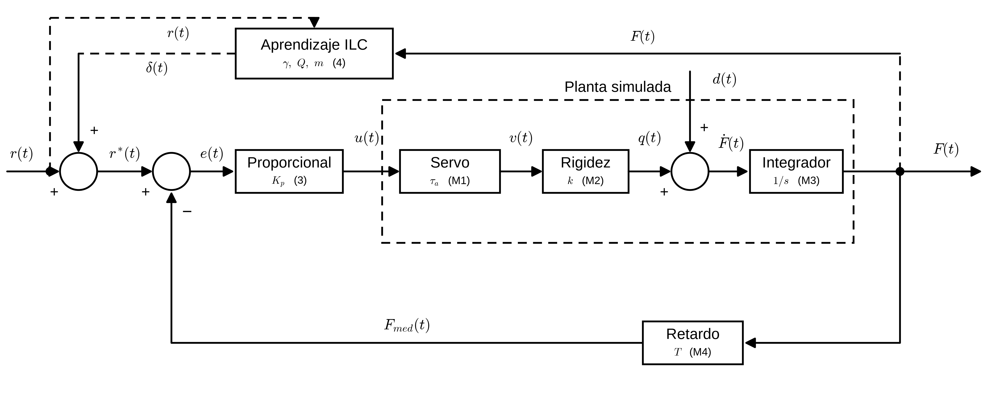
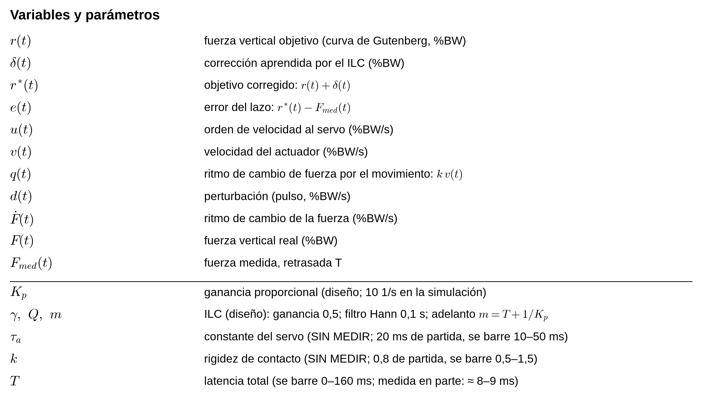
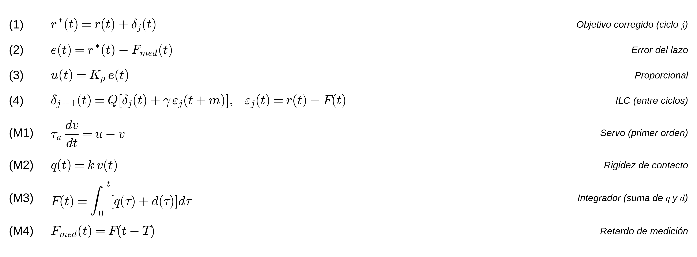

# Reporte del día — 2026-11-03

Etapa de control del simulador de marcha (Luis Plasencia). Sesión en el Raspberry Pi.

**Regla de este reporte:** cada tema trae *Objetivo → Metodología → Resultado → Limitaciones → Fuentes*. Todo dato es **medido**, **tomado de una fuente citada** o está marcado como **NO VERIFICADO / elección de diseño**. No se usan valores supuestos como si fueran datos.

## Índice
1. Estado del RPi · 2. Latencia de adquisición RPi + ADS1256 · 3. Retardo del amplificador AMTI · 4. Latencia acumulada · 5. Curva objetivo de Fz · 6. Duración del apoyo · 7. Simulación RT vs ILC · 8. Tipo de control (provisional) · 9. Firmware (propuesta) · 10. Pendientes · 11. Fuentes

---

## 1. Estado del RPi
- Luis reparó el RPi tras el incidente del 2026-11-02. Sesión gráfica en Wayland (`rpd-labwc`) para el modo táctil; el monitor (`herramientas/monitor_gaitsim.py`) abre bien.
- ADS1256 responde (STATUS=0x30; MUX/ADCON/DRATE leídos de vuelta coinciden con lo escrito).
- **ESP32 de motores:** no estaba conectado al inicio de la sesión; Luis lo conectó después (`/dev/ttyUSB0`). Prueba **solo de lectura** (no se envió `HOME` ni ningún movimiento; no se tocó la memoria de trayectorias): `PING` 5.37 ms de media (n=99/100; σ 10.25 ms por **un valor atípico de 106.7 ms** en la primera llamada, mínimo 1.98 ms), `GET_POSITION` 4.935 ms (σ 0.018), `TRAJ_STATUS` 4.923 ms (σ 0.088); posición `0:0:0` (sin HOME). Mismo orden que el 2026-11-02. Datos: `pruebas/latencia_comandos_2026-11-03.csv`.
- **Observación sin resolver:** AIN0 (Fz del AMTI) marcó −55 mV con 55 mV pico a pico en el diagnóstico de hoy; el 2026-11-02 estaba estable en +38.9 mV. Apunta a conexión/estado del AMTI.

## 2. Latencia de adquisición RPi + ADS1256 (Paso 2 del plan)
**Objetivo.** Medir cuánto tarda un cambio de tensión en aparecer como dato en el software del RPi (filtro digital del ADS1256 + SPI + Python), sin video (Luis no puede grabarlo).

**Metodología.** Escalón eléctrico: GPIO27 del RPi → divisor 10 kΩ/10 kΩ (Luis usó 10k/10k) → AIN1 (vs AINCOM). El instante del flanco (`t0`, justo antes de `GPIO.output()`) y el de detección salen del **mismo reloj** (`perf_counter_ns`). Niveles medidos: bajo 47 mV, alto 1613 mV. Se registra cuándo la lectura cruza el 50 % y el 90 % del salto. 200 escalones (100 subidas + 100 bajadas), fase aleatoria 20–70 ms respecto al muestreo, 1000 SPS. Script `pruebas/medir_latencia_gpio_adc.py`, datos `pruebas/latencia_gpio_adc.csv`. Conexión **temporal** (`esquemas/amti_ads1256_rpi/CONFIGURACION_ACTUAL.md`).

**Resultado** (0 fallos en 200):
| Punto del escalón | Media | σ | Máx |
|---|---|---|---|
| 50 % | 1.61 ms | 0.28 ms | 2.12 ms |
| 90 % | 2.40 ms | 0.28 ms | 2.90 ms |
Subida y bajada no difieren de forma relevante (50 %: 1.59 / 1.62 ms; 90 %: 2.40 / 2.40 ms).

**Limitaciones.** No incluye el amplificador del AMTI (ver §3). `t0` es una cota superior (la llamada a `GPIO.output()` tarda decenas de µs; no se midió). Un primer intento tenía un error en el umbral del 90 % de las bajadas (disparaba al 10 %); se corrigió y se repitió antes de reportar. También se corrigió `medir_latencia_escalon_amti.py` (tomaba `t` antes de leer, sesgo de hasta 1 ms). Con fuerza real y sin referencia independiente no se reporta un número absoluto.

## 3. Retardo del amplificador AMTI Gen 5
**Objetivo.** Conocer el retardo entre la fuerza aplicada y la tensión en la salida analógica del AMTI (el único tramo de latencia que falta para el lado de adquisición).

**Metodología.** (a) Se buscó en el manual (`referencias/amti_manual/AMTI_Gen5_User_Manual.pdf`, texto extraído con `pdftotext`): **no declara un retardo**. Sí declara, y se usó, lo siguiente: filtro anti-aliasing **1000 Hz pasa-bajos, Butterworth de 2 polos** (p. 55, § 10); filtro de reconstrucción de la salida analógica **1000 Hz, Butterworth de 3 polos** (p. 55); DAC de 16 bit con salida continua y **refresco de 2 kHz** (p. 12, § 2.5); la "tasa de adquisición" de NetForce (1000 Hz en el archivo `Trial00535.txt`) es solo para el flujo **digital por USB** (p. 27), no para la salida analógica. (b) Se calculó el **retardo de grupo** de cada filtro con la derivada numérica de la fase de los polos del Butterworth y se verificó contra la fórmula analítica (√2/ωc para 2 polos, 2/ωc para 3 polos). (c) Retenedor del DAC a 2 kHz: retardo medio = medio periodo. Script `pruebas/calcular_retardo_amti_manual.py`.

**Resultado.** A frecuencias de la marcha (≤ 200 Hz) el retardo de grupo casi no varía: 2 polos = 0.225 ms; 3 polos = 0.318 ms (a 1–10 Hz; 0.234 y 0.325 ms a 200 Hz). Retenedor DAC: 0.25 ms (rango 0–0.5 ms). **Cota inferior = 0.225 + 0.318 + 0.250 = 0.79 ms.**

**Búsqueda en internet (2026-11-03, 3 consultas):** no se encontró ninguna cifra publicada de retardo, latencia, retardo de fase ni respuesta en frecuencia de la salida analógica del Gen 5. Pistas, **no verificadas por mí**: (i) una nota técnica de AMTI "Gen 5 Setup and Optimization" referida en resultados de búsqueda (no se obtuvo); (ii) la documentación de QTM (Qualisys) indica un buffer de 16 muestras del Gen 5 en el flujo **digital**, no en el analógico. Del manual: en los dos modos de salida analógica (*Fully Conditioned* y *MSA 6 Compatible*) se aplica el mismo acondicionamiento salvo la corrección de diafonía (p. 28), así que el modo no cambia la cadena de filtros; no se sabe cuál modo usa Luis (la escala de 1.7665 mV/N con ganancia 2000 sugiere modo MSA 6, sin verificar).

**Limitaciones.** Es una **cota inferior**, no el retardo total: el manual menciona sobremuestreo y procesamiento digital de señal (§ 2.1) **sin dar su retardo**, y no se midió. **Para obtener el valor completo hay que consultar al soporte técnico de AMTI** (fuente oficial) por el retardo de grupo de la ruta salida analógica del Gen 5, o medirlo con un estímulo de referencia independiente; ninguna de las dos está hecha. Esta consulta/medición queda como pendiente de Luis.

## 4. Latencia acumulada del lazo (lo medido hasta hoy)
| Tramo | Valor | Estado |
|---|---|---|
| Amplificador AMTI (filtros + DAC) | ≥ 0.79 ms | cálculo desde manual (cota inferior; falta DSP interno) |
| ADS1256 + SPI + Python | 1.61 ms (50 %) / 2.40 ms (90 %) | medido (§2) |
| RPi ↔ ESP32 (RTT, `PING`→`PONG`) | 5.97 ms (σ 0.185, n=100) | medido el 2026-11-02; casi todo sondeo de 5 ms del firmware |
| Cómputo del controlador en el RPi | — | no medido |
| Ejecución en el ESP32 | — | no medido |
Suma parcial = **8.4 ms (50 %) a 9.2 ms (90 %)**, usando el RTT completo (ida y vuelta), que sobreestima el tramo de envío del comando; es una cota inferior del total porque faltan los tramos no medidos y el DSP del AMTI.

## 5. Curva objetivo de Fz
**Objetivo.** Reemplazar la curva sintética (inventada) y la del artículo propio (Luis indicó que no está del todo bien) por una referencia internacional verificada. **Decisión de Luis: el objetivo final es la curva de una persona sana.**

**Metodología.** Base pública *Gutenberg Gait Database* (Horst et al. 2021, DOI 10.1038/s41597-021-01014-6; datos CC0 en Figshare). Verificado en el artículo: fuerza vertical procesada (`F_V_PRO`) en múltiplos de peso corporal, normalizada a 101 puntos = 100 % del apoyo; marcha nivelada a velocidad autoseleccionada; 350 sujetos sanos de 11 a 64 años. Filtro: velocidad autoseleccionada (`SPEED=2`), sin plantilla ortopédica. Promedio por sujeto (todas sus pisadas) y luego media ± DE entre sujetos. Script reproducible `control/referencia_grf/extraer_referencia_gutenberg.py` (descarga los datos de Figshare); salida `referencia_fz_gutenberg.csv`.

**Resultado.** 350 sujetos, 8819 pisadas, velocidad de marcha 1.40 ± 0.16 m/s (n=284 con dato). **1.er pico 115.4 %BW (22 % del apoyo), valle 71.1 %BW (49 %), 2.º pico 117.8 %BW (78 %)**; DE entre sujetos 11.1 y 9.0 %BW en los picos.

**Limitaciones.** Es marcha **normal (1.40 m/s)**. El factor x6 estira el **tiempo**; no se verificó cómo cambia la amplitud de la fuerza a velocidades menores (la curva propia del simulador a 0.48 m/s mostró picos ≈ 100 %BW, valor leído de su figura 5c, no verificado de otra fuente). Qué amplitud es el objetivo físico del control a x6 queda **por decidir con Luis**.

## 6. Duración de la fase de apoyo
**Objetivo.** Fijar la duración del apoyo a x6 con una referencia, no con un supuesto.

**Metodología.** Misma base y mismo filtro que §5, archivo `GRF_F_V_RAW_right.csv`. Verificado en el artículo: señales submuestreadas a **250 Hz** y, en los datos crudos, **apoyo recortado con umbral de Fz = 25 N**. Cada pisada = muestras no-NaN; duración = n / 250 Hz. Media por sujeto, luego media ± DE entre sujetos. El factor **x6** es el confirmado por Luis (el "30x" del artículo de conferencia es dato viejo). Script `control/referencia_grf/duracion_apoyo_gutenberg.py`, salida `salida_duracion_apoyo.txt`.

**Resultado.** Apoyo = **0.615 s** (DE entre sujetos 0.047 s; rango entre sujetos 0.487–0.793 s; por pisada: mediana 0.604 s, p5 0.544, p95 0.696; 350 sujetos, 8819 pisadas). **A x6: 3.69 s** (rango 2.92–4.76 s). Velocidad equivalente de marcha: 1.40/6 ≈ 0.23 m/s (cálculo directo, no medida).

**Comprobación cruzada (fuente secundaria).** Una revisión (Frontiers in Neurology 2021, PMC8217618, Tabla 3, adaptada de Lai, Begg & Palaniswami 2009, DOI 10.1109/TITB.2009.2022913) da apoyo 0.62–0.70 s a 1.30–1.46 m/s. Coincide en orden de magnitud; el valor propio es algo menor, lo esperable con el umbral de 25 N que recorta los bordes. No se leyó la fuente primaria.

**Limitaciones.** Resolución de 4 ms. El apoyo está definido con Fz ≥ 25 N, no por contacto visual. Población de 11 a 64 años, no amputados.

## 7. Simulación de control en tiempo real vs ILC (sin hardware)
**Figura:** [`control/simulacion/rt_vs_ilc_latencia.png`](../control/simulacion/rt_vs_ilc_latencia.png) · código `control/simulacion/rt_vs_ilc_latencia.py` · números y sensibilidad `control/simulacion/salida_consola.txt` · notas `control/simulacion/NOTAS.md`.

### 7.1 Objetivo
Decidir entre control de fuerza **en tiempo real** (corregir al instante con la medida del AMTI) o **ILC** (aprender de un ciclo de marcha al siguiente). La latencia (§4) es lo que inclina la decisión. La simulación responde: **¿cuánta latencia aguanta cada estrategia y qué error de fuerza deja?**

### 7.2 Metodología y qué es dato vs. qué no
Modelo de un eje (Fz): servo de 1.er orden → contacto con rigidez efectiva → medición retrasada T. Métodos: **RT** (realimentación de ganancia Kp); **RT+FF** (RT más prealimentación de la derivada del objetivo, con rigidez estimada 20 % distinta de la real); **ILC** (RT + corrección aprendida al final de cada ciclo, con filtro de fase cero). Paso de integración 0.5 ms.
| Elemento | Valor | Estado |
|---|---|---|
| Fuerza objetivo | curva de §5 | **DATO** (fuente citada) |
| Duración del apoyo | 3.69 s (rango 2.92–4.76 s) | **DATO** (§6) |
| Latencia total T | se barre 0–160 ms | variable; **medido ≈ 8.4–9.2 ms parcial** (§4) |
| Constante del servo τ | 20 ms (barrido 10/20/50) | **NO MEDIDO**: valor de partida, se barre |
| Rigidez de contacto | real = 0.8 de la del modelo (barrido 0.5–1.5) | **NO MEDIDO**: valor de partida, se barre |
| Perturbación (panel d) | pulso de 3 %BW, 0.1 s | **elección de diseño**, sin impacto de talón |
| Kp = 10 s⁻¹; ILC γ = 0.5, filtro Hann 0.1 s | | **elecciones de diseño** del controlador simulado, no medidas |
| Margen de fase 45° para T máx | | **elección de diseño propia**; no tomada de una fuente verificada |
Los parámetros NO MEDIDOS se barren y se reporta la sensibilidad; **no se afirma su valor**.

### 7.2b Diagrama de bloques del lazo simulado
Archivos en `control/diagramas/salida/`: `diagrama.png/.svg`, `leyenda_variables.png/.svg`, `ecuaciones.png/.svg` (generados con `control/diagramas/diagrama_lazo_hibrido.py`, estilo del skill `diagrama-bloques-control`). Representa **exactamente** lo que simula `rt_vs_ilc_latencia.py`.

*Figura 7.1. Lazo de fuerza vertical simulado. El círculo es una suma con los signos indicados; el punto negro es una derivación; el recuadro punteado agrupa la planta simulada; las líneas punteadas del ILC indican que actúa **entre ciclos**, no dentro del ciclo; `(n)` indica la ecuación del controlador y `(Mn)` la del modelo de la planta, con el mismo número en la tabla de ecuaciones.*

**Cómo leerlo.** Camino de adelante: el objetivo `r` (curva de §5) se corrige con lo que aprendió el ILC (`δ`), se compara con la fuerza medida y retrasada (`F_med`), el controlador proporcional produce una orden de velocidad `u`, el servo la sigue con retardo (`τ_a`), el movimiento cambia la fuerza según la rigidez (`k`) y la perturbación `d`, y el integrador da la fuerza `F`. La medida vuelve por abajo con el retardo `T`. Lo numerado `(1)–(4)` es controlador (se puede cambiar); `(M1)–(M4)` es el **modelo de la planta, sin medir** (se supone y se barre). **Limitación:** el ILC usa `ε = r − F` con la fuerza real (equivalente a la medida desplazada `T`, posible porque corrige entre ciclos); no está dibujado el caso RT+FF.

### 7.3 Términos
- **%BW**: fuerza como % del peso corporal (10 %BW de error = 10 % del peso).
- **Error RMS**: tamaño típico de la diferencia entre fuerza pedida y lograda en todo el apoyo.
- **T máx (línea gris)**: retardo máximo antes de que el lazo pierda el margen de fase elegido.

### 7.4 Resultado y cómo leer cada panel
- **(a) Forma de Fz con T = 10 ms.** Negro punteado = curva real objetivo. **ILC (verde) y RT+FF (naranja) la tapan casi por completo; RT solo (rojo) llega tarde**, sobre todo en la subida y en el 2.º pico (atraso típico de un control que solo reacciona).
- **(b) Error RMS vs latencia** (eje logarítmico). A T = 10 ms: **RT 11.5 %BW, RT+FF 2.0, ILC 0.40**. ILC se mantiene ≈ 0.4–0.5 hasta 40 ms, sube a 0.78 (60 ms), 1.4 (80 ms), 3.4 (100 ms) y sale del gráfico hacia 130 ms (**inestable**). Línea gris = T máx analítico para Kp = 10 (60 ms). *Cuidado:* la curva roja **baja** al subir T hasta ~80 ms; no es que el retardo ayude, es que adelanta la fuerza real y compensa en parte el atraso del modelo mientras el lazo pierde margen (igual el mínimo naranja).
- **(c) Aprendizaje del ILC.** Cada punto es un ciclo: con T = 10 ms el error baja de 12.0 %BW (ciclo 1) a 0.40 (ciclo 12); con T = 60 ms de 8.1 a **0.78 y se estanca**. ILC necesita ~12 ciclos y solo sirve si el ciclo se repite igual.
- **(d) Con perturbación que no se repite.** ILC 0.67 %BW a T = 10 ms (RT 11.6). No prueba que ILC rechace perturbaciones reales: aquí solo hay un pulso pequeño.
- **T máx analítico según la ganancia de lazo** (τ = 20 ms, margen 45°): 5 → 138 ms; 8 → 80 ms; 10 → 60 ms; 15 → 35 ms; 20 → 23 ms; 40 → 6 ms (la ganancia efectiva es Kp × rigidez real).
- **RT según Kp** (T = 10 ms): Kp 5 → 18.9 %BW; 10 → 11.5; 20 → 5.9.
- **Sensibilidad a lo no medido** (T = 10 ms, Kp = 10): barriendo τ ∈ {10, 20, 50 ms} × rigidez ∈ {0.5, 0.8, 1.0, 1.5}: **RT 6.1–17.9 %BW, ILC 0.21–1.56 %BW**. Barriendo el apoyo (2.92 / 3.69 / 4.76 s): RT 14.0 / 11.5 / 9.3, ILC 0.85 / 0.40 / 0.21. ILC queda por debajo de RT en todos los casos probados.

### 7.5 Limitaciones y qué NO se puede decir
- No se identificó la planta real: τ del servo, rigidez de contacto por prótesis, impacto de talón, fricción/holguras, saturación de velocidad del husillo → **no se puede afirmar que ILC sea mejor que RT en el simulador real**, ni un límite de latencia del simulador.
- No hay latencia total (faltan DSP del AMTI, cómputo del RPi, ejecución del ESP32).
- La amplitud del objetivo a x6 está por decidir (§5).
- Lo que sí se puede decir **dentro del modelo**: la latencia fija un techo al ancho de banda del tiempo real; con la latencia medida (≈ 8–9 ms parcial) y Kp = 10 el error de RT lo domina el ancho de banda, no la latencia; ILC reduce el error repetible a ≈ 0.4 %BW en 12 ciclos.

### 7.6 Cómo explicarlo en 30 segundos
"Usé la curva real de fuerza vertical de 350 personas sanas y la duración real del apoyo de esa misma base, multiplicada por 6. Simulé un lazo de fuerza variando la latencia: el control en tiempo real llega tarde (≈ 11 %BW de error) y el ILC sigue la curva (≈ 0.4 %BW) tras unos 12 ciclos, aguantando bastante retardo. Con la latencia que medí (≈ 8–9 ms) el retardo no es el problema principal. La planta la barrí porque aún no está medida; lo siguiente es medir el servo y la rigidez reales."

## 8. Tipo de control — propuesta PROVISIONAL
Detalle en [`control/DECISION_TIPO_CONTROL.md`](../control/DECISION_TIPO_CONTROL.md). **Propuesta:** híbrido por eje (Fz, Fy) = realimentación de fuerza en tiempo real + ILC ciclo a ciclo encima. Se apoya en §4 y §7, con las limitaciones de §7.5. **No está cerrada**: falta identificar servo y rigidez, la latencia restante y la confirmación de la asesora.

## 9. Firmware del ESP32: interfaz de movimiento (leída del código, no probada) y decisión de no modificarlo
**Objetivo.** Saber qué puede hacer el firmware actual antes de decidir el tipo de control, y no afectar un ESP32 que funciona (decisión de Luis: **no se modifica el firmware**).

**Metodología.** Lectura de `Codigo ESP32 MOV/platformIO_control_trayectoria_v1/src/` (`main.cpp`, `communication.h`, `hardware_config.h`, `configurable_motion_data.h`, `description.md`) y de la sección de motores del artículo de conferencia (`conferencia_copy.pdf`). No se ejecutó nada que mueva motores.

**Resultado (verificado en el código y en el artículo).**
- **Motores** (artículo): los ejes **horizontal y vertical** usan servomotores AC (A6M80-750H2·1-M17, 0.75 kW, 3000 rpm; el vertical con freno) con drivers servo de lazo cerrado A6-750RS de **entradas de pulso y dirección** opto-aisladas (hasta 100 kHz); solo el eje **sagital** es un motor a pasos de lazo cerrado (34E1K-120, driver CL86Y). El firmware los llama "stepper" por la interfaz STEP/DIR.
- **Órdenes disponibles:** `PING`, `HOME`, `MANUAL` (relativo, en pasos, **a la velocidad fija de homing de cada eje**: no recibe velocidad), `GOTO` (absoluto), `GET_POSITION`, carga de trayectoria (`TRAJ_BEGIN`/`TRAJ_POINT`/`TRAJ_END`), `RUN`/`PAUSE`/`RESUME`/`ABORT` y `TRAJ_STATUS`.
- **Cada movimiento** (`axis_move_steps`) es una ráfaga de pasos a **frecuencia constante** generada por un temporizador de hardware, sin rampa de aceleración en el firmware; si el eje ya se está moviendo, la nueva orden se **ignora** sin aviso.
- **Trayectoria temporizada:** hasta `MAX_DATA_LENGTH = 500` puntos, cada uno con (`dt_ms`, pasos en X, Y, K); se ejecuta punto a punto con `vTaskDelay(dt_ms)` (resolución 1 ms).
- **Consecuencia (deducida del código):** **no existe una orden para cambiar posición o velocidad de forma continua mientras el eje se mueve**; por eso un lazo de fuerza en tiempo real a cientos de Hz **no es posible con la interfaz actual sin cambiar el firmware**. En cambio, **ILC es compatible sin tocar el firmware**: entre ciclos se modifican los arreglos de pasos y se recargan con `TRAJ_*`. **Por confirmar (no medido):** el tiempo de carga (si cada `TRAJ_POINT` tarda ≈ 5 ms como las otras órdenes, 500 puntos serían ≈ 2.5 s, **estimación**), si se puede cargar durante `RUN` (los arreglos se comparten: no se asume), y cuánto dura el hueco entre ciclos.

**Cambio propuesto antes (sondeo RX de 5 ms → 1 ms):** queda **como propuesta opcional, NO aplicada y NO necesaria** para la fase ILC (ver `Codigo ESP32 MOV/CAMBIOS_PENDIENTES_DESDE_RPI.md`); solo bajaría ≈ 3–5 ms de latencia de comunicación.

**Limitaciones.** Lectura de código, sin prueba en hardware; el artículo es la fuente de los modelos de motor (Luis indicó que usa motores a pasos: en X/Y el artículo dice servos AC, **por confirmar con Luis** si el hardware cambió).

## 10. Pendientes
1. **AMTI:** consultar a soporte técnico de AMTI el retardo de la salida analógica del Gen 5 (o medirlo con una referencia independiente) — Luis.
2. **Amplitud del objetivo de Fz a x6** — decisión de Luis (§5).
3. Revisar AIN0 inestable (monitor abierto, plato vacío); repetir offset y calibración con pesas (`pruebas/calibracion_pesas.py`, sin ejecutar); revisar la pérdida de muestras del monitor (≈ 928/s vs 1000).
4. Identificar la respuesta del servo vertical y la rigidez de contacto con ≥ 2 prótesis (protocolo propuesto en `control/identificacion/PROTOCOLO.md`, **no ejecutado**); repetir la simulación con impacto de talón.
   - Medir el tiempo de carga de trayectoria (`TRAJ_BEGIN/POINT/END`): sobrescribe la trayectoria en RAM del ESP32 (sin mover motores); **requiere OK de Luis**.
   - Opcional, sin cambiar firmware: leer con un GPIO del RPi la señal STEP del ESP32 (3.3 V, GND común, resistencia en serie) para medir la latencia de ejecución; **requiere cableado de Luis**.
5. Conectar el ESP32 de motores para el Paso 3 (latencia total); medir cómputo del RPi y ejecución del ESP32.
6. (Opcional, **no se modifica el firmware por decisión de Luis**) cambio de sondeo RX; solo si más adelante se necesita menos latencia.
7. Respuesta de Dante Elías y confirmación de la asesora (sin novedad).

## 11. Fuentes
- Horst F, Slijepcevic D, Simak M, Schöllhorn WI. *Gutenberg Gait Database, a ground reaction force database of level overground walking in healthy individuals.* Sci Data 8:232 (2021). DOI 10.1038/s41597-021-01014-6. Datos CC0: Figshare colección 10.6084/m9.figshare.c.5311538 (archivos 26576491, 26576493, 26576495, 26576497).
- AMTI. *Gen 5 User Manual*, `referencias/amti_manual/AMTI_Gen5_User_Manual.pdf` (pp. 11–12, 27, 55).
- Revisión usada solo como comprobación cruzada (fuente secundaria): Frontiers in Neurology 2021, PMC8217618, Tabla 3; datos adaptados de Lai DT, Begg RK, Palaniswami M. IEEE Trans Inf Technol Biomed 13:687–702 (2009), DOI 10.1109/TITB.2009.2022913 (no leída).
- Mediciones propias: `pruebas/latencia_gpio_adc.csv`, `pruebas/latencia_ping_pong.csv`, `pruebas/2026-11-02_latencia_amti_rpi_esp32.md`.
