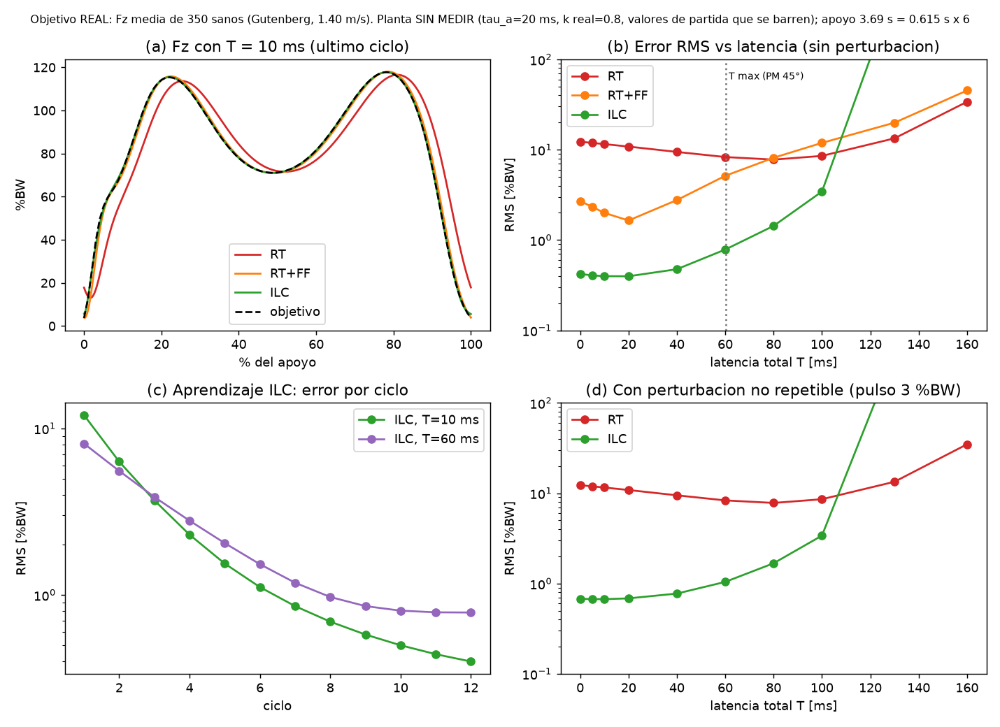

# Reporte del día — 2026-11-03

Continuación de la etapa de control del simulador de marcha (sesión en el Raspberry Pi).

## 1. Estado del RPi
- Luis reparó el RPi tras el incidente del 2026-11-02. Sesión gráfica en **Wayland (`rpd-labwc`)** para recuperar el modo táctil (`/etc/lightdm/lightdm.conf`); el monitor (`herramientas/monitor_gaitsim.py`) abre bien bajo Wayland.
- ADS1256 responde (STATUS=0x30, MUX/ADCON/DRATE leídos de vuelta correctos). **ESP32 de motores: NO conectado hoy** (no hay `/dev/ttyUSB0`).
- **Observación a revisar:** AIN0 (Fz del AMTI) dio −55 mV con 55 mV pico a pico en el diagnóstico (el 2026-11-02 estaba estable en +38.9 mV). Apunta a conexión/estado del AMTI; no resuelto.

## 2. Latencia de adquisición RPi + ADS1256 (Paso 2) — MEDIDA
Sin video (Luis no puede grabarlo), así que se usó un **escalón eléctrico**: GPIO27 del RPi → divisor 10k/10k → AIN1 (vs AINCOM). Mismo reloj (`perf_counter_ns`) para el flanco y para la detección. Script: `pruebas/medir_latencia_gpio_adc.py`; datos: `pruebas/latencia_gpio_adc.csv`.
- Niveles: bajo 47 mV, alto 1613 mV (salto 1.566 V). 1000 SPS.
- n = 200 (100 subidas + 100 bajadas), 0 fallos.

| Punto del escalón | Media | σ | Máx |
|---|---|---|---|
| 50 % | 1.61 ms | 0.28 ms | 2.12 ms |
| 90 % | 2.40 ms | 0.28 ms | 2.90 ms |

- Incluye: filtro digital del ADS1256 + SPI + software Python. Subida y bajada sin diferencia relevante.
- **No incluye** el retardo del amplificador analógico del AMTI (sale del manual AMTI; no medido).
- Incertidumbre de t0: se toma justo antes de `GPIO.output()` (cota superior, decenas de µs).
- Un primer intento tenía un error en el umbral del 90 % de las bajadas (disparaba al 10 %); corregido antes de reportar.
- Conexión del divisor: **temporal** (`esquemas/amti_ads1256_rpi/CONFIGURACION_ACTUAL.md`).

## 3. Cambios de código
- `pruebas/medir_latencia_gpio_adc.py` (nuevo).
- `pruebas/medir_latencia_escalon_amti.py`: `t` se toma después de leer (antes sesgaba hasta 1 ms).

## 4. Latencia acumulada hasta ahora
| Tramo | Valor | Estado |
|---|---|---|
| Amplificador AMTI | — | pendiente (manual) |
| ADS1256 + SPI + Python | 1.6 ms (50 %) / 2.4 ms (90 %) | medido |
| RPi ↔ ESP32 (RTT, incl. polling 5 ms del firmware) | 5.97 ms | medido |
| Cómputo RPi del controlador | — | pendiente |
| Ejecución en ESP32 (comando → motor) | — | pendiente |
Parcial ≈ 8–9 ms. El umbral tolerable lo da la simulación (tiempo real vs ILC); sin él no se concluye.

## Pendiente
1. Simulación de control en tiempo real vs ILC con la latencia como variable (no requiere hardware).
2. Revisar AIN0 inestable (con el monitor abierto).
3. Repetir offset con el plato vacío y calibración con pesas (`pruebas/calibracion_pesas.py`, sin ejecutar); revisar la pérdida de muestras del monitor (≈928/s vs 1000).
4. Retardo del amplificador del AMTI desde el manual.
5. Conectar el ESP32 de motores para el Paso 3 (latencia total).
6. Respuesta de Dante Elías y confirmación de la asesora (sin novedad).

## 5. Simulación de control en tiempo real vs ILC (sin hardware)
**Figura:** [`control/simulacion/rt_vs_ilc_latencia.png`](../control/simulacion/rt_vs_ilc_latencia.png) · código: `control/simulacion/rt_vs_ilc_latencia.py` · números: `control/simulacion/salida_consola.txt` · índice de la carpeta: `control/README.md`.

### 5.1 Por qué se hizo
Hay que decidir si el control de fuerza (Fz, Fy) se hace **en tiempo real** (corregir en cada instante con lo que mide el AMTI) o con **ILC** (aprender de un ciclo de marcha a otro). Lo que inclina la decisión es la **latencia**: el tiempo entre que la fuerza real cambia y el motor recibe una orden basada en esa medición. Ya medí parte de esa latencia (sección 2 y 4). Esta simulación responde: **¿cuánta latencia aguanta cada estrategia y qué error de fuerza deja?** Así se sabe qué falta medir antes de decidir.

### 5.2 Qué se usó (todo es un MODELO con supuestos, no el simulador real)
| Elemento | Valor | Origen |
|---|---|---|
| Latencia total T | se barre de 0 a 160 ms | **es la variable**; medido hasta ahora ≈ 8–9 ms (parcial) |
| Ciclo de apoyo | 4 s | supuesto (≈ 0.67 s reales × 6, velocidad x6) |
| Servo del eje | respuesta de 1.er orden, 20 ms | **supuesto, sin medir** |
| Rigidez de contacto | real = 0.8 de la que "cree" el modelo | **supuesto** (en la realidad cambia con cada prótesis) |
| Fuerza objetivo | doble pico, 97.4 y 102.5 %BW al 19 % y 45 % | picos de la curva propia del simulador (conferencia, Fig. 5c); **la forma entre picos es inventada** |
| Perturbación (panel d) | pulso de 3 %BW, 0.1 s, aleatorio | supuesto; **no incluye impacto de talón** |
Lo único medido de verdad es la latencia. El resto hay que identificarlo en el simulador (ver 5.5).

### 5.3 Términos (en simple)
- **%BW**: fuerza como porcentaje del peso corporal. Un error de 10 %BW es un error del 10 % del peso.
- **Error RMS**: tamaño "típico" de la diferencia entre la fuerza pedida y la lograda a lo largo de todo el ciclo. Menor = mejor.
- **RT (tiempo real)**: el controlador mira la fuerza medida y corrige al instante, con una ganancia Kp (qué tan fuerte corrige).
- **RT+FF**: igual, pero además se le "adelanta" la pendiente de la curva objetivo (prealimentación); depende de conocer bien la rigidez.
- **ILC**: el mismo control, más una corrección que se **aprende al terminar cada ciclo** y se aplica en el siguiente.
- **Margen de fase / T máx (línea punteada gris)**: cuánto retardo aguanta el lazo antes de volverse oscilante o inestable. Aquí se pide un margen de 45°, que es un criterio de diseño usual.

### 5.4 Cómo leer cada panel y qué se observa
- **(a) Forma de la fuerza con T = 10 ms.** La línea negra punteada es lo que queremos. **ILC (verde) y RT+FF (naranja) la tapan casi por completo**: la siguen bien. **RT solo (rojo) llega tarde** y se ve corrido a la derecha, sobre todo en la subida: es el atraso típico de un control que solo reacciona. Esta es la imagen para explicar el problema en una frase.
- **(b) Error RMS vs latencia** (eje vertical en escala logarítmica: cada raya es 10 veces más). Qué mirar: (1) la verde (ILC) está ~30 veces más abajo que la roja (RT) mientras T sea moderado; (2) la verde casi no cambia hasta ~100 ms y luego **se dispara** (sale del gráfico: lazo inestable, no una curva "mala"); (3) la línea gris en 60 ms marca el límite de estabilidad para esta ganancia; (4) **cuidado con la roja**: baja al subir la latencia. No significa que el retardo ayude: es una compensación casual del modelo (el retardo "adelanta" la fuerza real y tapa el atraso) mientras el lazo se acerca a la inestabilidad. Lo mismo explica el mínimo de la naranja en 20 ms.
- **(c) Aprendizaje del ILC.** Cada punto es un ciclo de marcha. El error baja de ≈ 9 %BW en el ciclo 1 a ≈ 0.3 %BW hacia el ciclo 10 (T = 10 ms). Con T = 60 ms baja más rápido al inicio pero **se estanca en ≈ 0.5 %BW**: más latencia deja un error final mayor. Mensaje: ILC necesita ~10 ciclos para "aprender", y lo aprendido solo sirve si el ciclo se repite igual.
- **(d) Con una perturbación que no se repite.** ILC (verde) sube un poco (0.5–1.5 %BW) pero sigue mejor que RT (≈ 9 %BW) con este pulso pequeño. **No es una prueba de que ILC sea mejor ante perturbaciones reales**: ILC no puede "aprender" algo que cambia cada ciclo, y aquí solo se probó un pulso chico.

### 5.5 Qué se puede y qué no se puede decir
**Se puede decir (bajo estos supuestos):**
- La latencia pone un **techo al ancho de banda** del control en tiempo real: con T máx de 60 ms se puede usar Kp=10, con 23 ms solo Kp=20 y con 6 ms Kp=40 (cuanto más rápido se quiere corregir, menos retardo se tolera).
- Con la latencia medida hasta ahora (≈ 8–9 ms parcial), a Kp=10 **la latencia no es lo que domina el error**; lo domina el ancho de banda del lazo (Kp=5: 17 %BW, Kp=10: 9.2, Kp=20: 4.4).
- ILC reduce el error repetible a ≈ 0.3 %BW en ~10 ciclos y tolera bien la latencia.

**NO se puede decir todavía:**
- Que ILC sea mejor que tiempo real: faltan los parámetros reales del simulador (constante del servo, rigidez de contacto por prótesis), el impacto de talón y la fricción/holguras del husillo.
- Que 60 ms (o cualquier cifra) sea el límite del simulador real: sale de los supuestos.
- Una latencia total: faltan el amplificador del AMTI (manual), el cómputo del RPi y la ejecución del ESP32.

**Para cerrarlo:** identificar el servo vertical y la rigidez de contacto (escalón de velocidad + AMTI + sensor de posición), medir la latencia restante, y repetir esta simulación con esos valores.

### 5.6 Cómo explicarlo en 30 segundos
"Simulé un lazo de fuerza con la latencia como variable. El control en tiempo real llega tarde a la curva porque solo reacciona; el ILC la sigue casi exacto después de unos 10 ciclos y aguanta mucho más retardo. Con la latencia que medí hasta ahora (unos 8–9 ms), el retardo no es el problema principal sino el ancho de banda. Todo esto es con un modelo supuesto; lo siguiente es medir el servo y la rigidez reales para confirmar."

## 6. Tipo de control — propuesta provisional
Detalle y justificación en [`control/DECISION_TIPO_CONTROL.md`](../control/DECISION_TIPO_CONTROL.md). **Propuesta:** control híbrido por eje (Fz, Fy) = realimentación de fuerza en tiempo real como base + ILC ciclo a ciclo encima. Se apoya en la simulación (§ 5, con supuestos) y en la latencia medida; **no está cerrada**: faltan servo y rigidez reales, la latencia restante y la confirmación de la asesora.

## 7. Firmware del ESP32 — propuesta (no aplicada)
`communication_rx()` espera con `vTaskDelay(5 ms)` en **dos** sitios (primer byte y bytes siguientes del mensaje), por eso el RTT de 5.97 ms es casi todo sondeo. Parche propuesto (sondeo de 1 ms) en `control/firmware/reducir_polling_rx.patch`, explicación en `control/firmware/README.md`. **No compilado ni probado**; se aplica y flashea desde la laptop y se mide de nuevo con `medir_latencia_ping_pong.py`.
