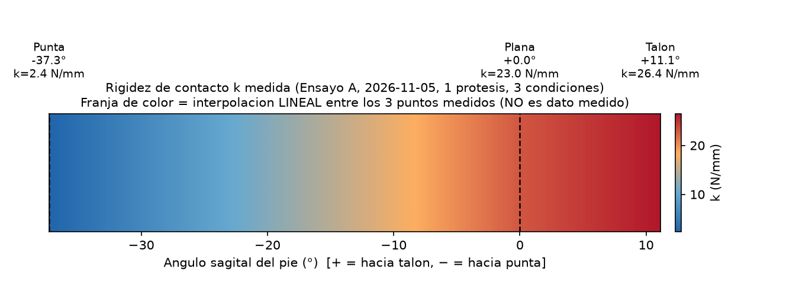

# Análisis: qué rigidez `k` usar como "ganancia conservadora" fija (Etapa 1 del lazo de Fz)

**Sesión:** laptop, sin RPi/ESP32. Corrige una decisión tomada minutos antes en la misma conversación (ver `CLAUDE.md`, `control/ilc/README.md`).

## Objetivo
Definir qué valor de rigidez de contacto `k` (N/mm), de los 3 medidos en el Ensayo A (2026-11-05), usar como ganancia FIJA `rigidez_n_por_mm` en `control/ilc/fz_ilc.py` para la primera prueba del lazo de Fz (Etapa 1, antes de tener gain-scheduling por CoP en tiempo real, Etapa 2).

## Metodología
Derivación algebraica de la relación entre la fuerza que el controlador *pide* corregir (`F_comandada`) y la fuerza *real* que produce el movimiento, cuando el `k` real de la zona de apoyo no coincide con el `k` asumido en el cálculo de pasos.

`fz_ilc.py` usa: `pasos_por_n = PASOS_POR_MM_Y / k_asumido` (pasos por cada N que el controlador quiere corregir).

Para una corrección deseada `F_comandada`:
- `Δpasos = F_comandada · pasos_por_n = F_comandada · PASOS_POR_MM_Y / k_asumido`
- `Δx_mm = Δpasos / PASOS_POR_MM_Y = F_comandada / k_asumido`
- `F_real = Δx_mm · k_real = F_comandada · (k_real / k_asumido)`

Es decir: **la razón `k_real / k_asumido` es un multiplicador de la ganancia del lazo** respecto a lo que se diseñó asumiendo que `F_real = F_comandada` (razón = 1).

## Resultado
Con los 3 `k` medidos (talón 26.4, plana 23.0, punta 2.4 N/mm):

| `k_asumido` (Etapa 1) | Zona real | `k_real/k_asumido` | Efecto |
|---|---|---|---|
| **Punta (2.4)** — elección inicial, INCORRECTA | Talón (26.4) | **11.0** | Lazo aplica 11× más fuerza de la pedida — más agresivo de lo diseñado, riesgo de sobre-impulso/inestabilidad. Y talón/plana es la mayor parte del apoyo, no un caso raro. |
| **Talón (26.4)** — elección corregida | Punta (2.4) | **0.09** | Lazo aplica solo el 9% de la fuerza pedida — ~11× más lento de lo diseñado, pero nunca más agresivo. |
| Talón (26.4) | Plana (23.0) | 0.87 | Cerca de 1, desempeño casi nominal. |

**Conclusión: la elección conservadora correcta para Etapa 1 es el `k` MÁS RÍGIDO medido (talón, 26.4 N/mm), no el más blando.** Asumir el más blando (como se decidió inicialmente en esta misma sesión, antes de este análisis) produce una ganancia de lazo *mayor* a la diseñada en la mayor parte del apoyo — exactamente lo opuesto de "conservador". Asumir el más rígido garantiza que la ganancia real nunca supera la diseñada en ningún punto del rango medido; el costo es una respuesta hasta 11× más lenta cerca de la punta, aceptado hasta que la Etapa 2 (ganancia variable por CoP) lo corrija.

Valor a usar en Etapa 1: `rigidez_n_por_mm = 26.4` → `pasos_por_n = 80/26.4 ≈ 3.03` pasos/N.

**Figura — mapa de calor de `k` medido:**

(`control/identificacion/resultados/mapa_calor_k_2026-11-06.png`, script: `control/identificacion/mapa_calor_k.py`). Los 3 puntos marcados (líneas punteadas, etiquetados con ángulo y `k`) son los ÚNICOS datos medidos; la franja de color entre ellos es una interpolación lineal puramente visual, no un dato medido — se indica así en el título de la figura.

## Limitaciones
- Solo 3 puntos medidos (talón, plana, punta), todos de una sola prótesis, en ensayo estático (ángulo fijo, sin desplazamiento del punto de contacto como en marcha real). No se sabe si existe algún punto intermedio con `k` aún más rígido que 26.4 — el margen de seguridad asume que el máximo medido es representativo del máximo real.
- El análisis es puramente de ganancia estática (relación fuerza-paso); no incluye el efecto de la dinámica del lazo completo (retardo, filtro, ganancia Kp del RT) sobre el margen de estabilidad real — eso requiere simulación o prueba en hardware.
- No se ha probado en hardware: esto es un análisis de diseño, no una medición.

## Fuentes
- `control/identificacion/ESTADO_Y_PENDIENTES_para_retomar.md` (valores de `k` medidos, 2026-11-05).
- `control/ilc/fz_ilc.py` (fórmula `pasos_por_n = PASOS_POR_MM_Y / rigidez_n_por_mm`).
- Derivación algebraica propia, verificada en esta sesión.
