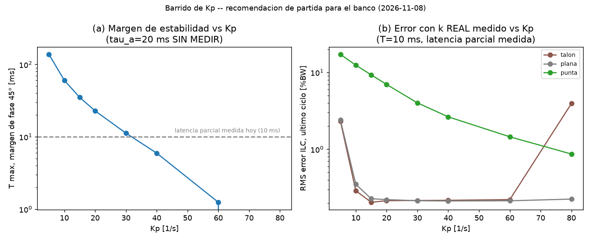

# Avance sin RPi (2026-11-08): fix de firmware, recomendación de Kp, protocolo SET_VEL aclarado

**Sesión:** laptop, sin RPi/ESP32. Todo lo de abajo es diseño/análisis — nada probado en hardware real.

## 1. Fix de firmware: `RUN` ya no se bloquea por el eje Y en modo `SET_VEL`
Ver `reportes/2026-11-08_fix_firmware_run_set_vel.md` y `control/firmware/README.md` punto 5. Resumen: el patch `control_velocidad_continua.patch` rechazaba `RUN` (necesario para mover X/sagital por la trayectoria del montaje 37) mientras el eje Y estuviera en `SET_VEL` (necesario para el lazo cerrado de Fz) — bloqueaba justo la arquitectura objetivo. Corregido: la condición ya solo chequea `axis_x`/`axis_k`, no `axis_y`. Verificado con `git apply --check`. **No compilado ni flasheado.**

## 2. Protocolo SET_VEL: SÍ responde (OK/BUSY), no es "fire and forget"
**Objetivo:** confirmar si `SET_VEL` espera respuesta del ESP32 o no, antes de confiar en `control/lazo_fz_tiempo_real.py`.

**Metodología:** lectura directa de `Codigo ESP32 MOV/platformIO_control_trayectoria_v1/src/main.cpp` y `communication.h` (no el patch, el firmware base).

**Resultado:** `primary_task` (el loop principal del ESP32) es siempre:
```c
while(1){
  communication_rx(rxPacket);     // bloqueante, espera <...>
  command_dispatcher(rxPacket, txPacket);
  communication_tx(txPacket);     // SIEMPRE manda una respuesta
}
```
`handle_velocity_command` (el handler de `SET_VEL` en el patch) llena `txPacket` con `OK` o `BUSY` igual que cualquier otro comando (`MANUAL`, `GOTO`, etc.) — no hay ninguna excepción para `SET_VEL`. Es el mismo mecanismo ya usado para medir el RTT de `PING`/`PONG` (5.97 ms, ver `CLAUDE.md`).

**Se corrigió** `control/lazo_fz_tiempo_real.py` (`ClienteVelocidadESP32.set_vel`): antes asumía fire-and-forget (sin leer nada); ahora lee y descarta la respuesta tras cada `SET_VEL`, con aviso si llega `BUSY` o algo inesperado. Si no se lee, las respuestas se habrían ido acumulando en el buffer serial del lado RPi — no habría roto nada de inmediato, pero habría desincronizado la lectura más adelante.

**Limitación:** esto es lectura de código, no medición. El RTT real de `SET_VEL` con el servo en movimiento (el ADC ya mostró que el servo degrada el SPI, puede pasar algo parecido al serial) **no está medido** — queda en el checklist RPi (§4).

## 3. Recomendación de `Kp` de partida (barrido de ganancia)
**Objetivo:** antes de este análisis solo se había usado `Kp=10` como ejemplo en la simulación, sin justificar por qué. Se necesita un valor de arranque documentado para el banco.

**Metodología:** barrido de `Kp` ∈ {5,10,15,20,30,40,60,80} 1/s en `control/simulacion/rt_vs_ilc_latencia.py`, evaluando dos cosas a la vez: (a) margen de estabilidad analítico (`T_max` a 45° de margen de fase, con `tau_a=20 ms` SIN MEDIR — valor de partida típico, se mantiene igual que el resto de la simulación); (b) error RMS del ILC en el último ciclo con el `k` REAL de las 3 condiciones del Ensayo A, a la latencia parcial medida hoy (T=10 ms).

**Resultado:**



(`control/simulacion/barrido_kp_2026-11-08.png`.) Panel (a): el margen de estabilidad (`T_max`) cae rápido al subir `Kp`, cruza los 10 ms de latencia ya medidos cerca de `Kp≈28`. Panel (b): el error del ILC en punta baja mucho con más `Kp` (de 12.4 a <3 %BW), pero en talón/plana ya está casi en el piso desde `Kp=10` — y en talón vuelve a subir en `Kp=80` (empieza a perder estabilidad, no se ve en el panel (a) porque ese análisis es lineal).

| Kp [1/s] | T_max (margen 45°) [ms] | error talón [%BW] | error plana [%BW] | error punta [%BW] |
|---|---|---|---|---|
| 10 | 60.3 | 0.29 | 0.35 | 12.41 |
| **15** | **35.0** | **0.20** | **0.23** | **9.30** |
| 20 | 22.8 | 0.21 | 0.22 | 6.96 |
| 30 | 11.2 | 0.22 | 0.21 | 4.01 |
| 40 | 5.9 | 0.22 | 0.21 | 2.64 |

**Recomendación: `Kp = 15 1/s` como valor de PARTIDA para el banco** (motores desconectados primero). Razón: la latencia total real todavía no está medida completa (falta cómputo RPi + ejecución ESP32, suma parcial hoy ≈10 ms) — `Kp=15` da `T_max=35 ms`, **3.5× de margen** sobre los 10 ms ya medidos, dejando espacio para lo que falta medir sin cruzar el límite de estabilidad. Mejora el error de punta de 12.4 a 9.3 %BW respecto a `Kp=10` sin casi costo en talón/plana (ya están muy bajos). `Kp=20` es la siguiente opción natural una vez que la latencia total esté medida y confirmada con margen (T_max=22.8 ms, todavía ≥2× los 10 ms parciales). **No usar `Kp≥40` sin medir la latencia completa primero** — el margen se vuelve menor a 6 ms, por debajo de lo ya medido en RPi↔ESP32 solo.

**Limitaciones:** `tau_a` (constante del servo) sigue sin medir — este barrido usa 20 ms como valor de partida, no un dato; si el servo real es más lento, `T_max` baja para el mismo `Kp` (ver sensibilidad ya documentada en `NOTAS.md`). El análisis de estabilidad es lineal (margen de fase); la simulación no lineal (saturaciones, límites de carrera) no se probó en estos barridos.

## 4. CHECKLIST — qué queda por confirmar/medir CON LA RPi (no se puede avanzar más sin ella)
En orden recomendado:
1. **USB/tierra del ESP32** — medir diferencia de tierra Pi↔ESP32 con el servo vertical en movimiento (`reportes/PROBLEMA_PENDIENTE_desconexion_USB_ESP32.md` §6). Bloquea todo lo demás.
2. **Compilar y flashear** `control_velocidad_continua.patch` (ya con el fix de `RUN` aplicado) — protocolo paso a paso ya en `control/firmware/README.md`.
3. **Confirmar en banco que `SET_VEL` responde `OK`/`BUSY` como se dedujo del código** (§2) — con motores desconectados, mandar `SET_VEL` manual y ver la respuesta real.
4. **Medir el RTT real de `SET_VEL`** con el servo vertical en movimiento (no solo `PING`/`PONG` en reposo) — el ADC ya mostró que el servo degrada otras señales (SPI), puede pasar algo parecido al serial; si el RTT sube con el servo activo, `dt_control_s=10 ms` podría no alcanzar.
5. **Probar el watchdog** (80 ms) — confirmar que el eje se detiene solo si se deja de mandar `SET_VEL`.
6. **Medir la constante del servo `tau_a`** (Ensayo B, no hecho todavía) — hoy se usa 20 ms como valor de partida sin medir; cambia directamente el `T_max` del barrido de `Kp` (§3).
7. **Medir la latencia completa del lazo** (AMTI + ADC + cómputo RPi + `SET_VEL` + ejecución ESP32) — hoy solo hay ≈10 ms parciales; confirma si `Kp=15` (o `Kp=20`) sigue teniendo margen suficiente.
8. **Elegir `Kp` definitivo** contra la latencia y `tau_a` ya medidos (no solo supuestos) — usando el mismo barrido de `control/simulacion/rt_vs_ilc_latencia.py`, re-ejecutado con los valores reales.
9. **Correr `control/lazo_fz_tiempo_real.py`** por primera vez — tiene un `SystemExit` a propósito hasta que 1-5 estén resueltos; quitar esa guarda recién entonces.
10. **Integrar con X/sagital** (`RUN` simultáneo con Y en `SET_VEL`) — ya tiene el firmware corregido (§1), falta probarlo en banco.

## Fuentes
- `Codigo ESP32 MOV/platformIO_control_trayectoria_v1/src/main.cpp`, `communication.h` (protocolo SET_VEL, leído directo).
- `control/simulacion/rt_vs_ilc_latencia.py` (barrido de Kp, código propio de esta sesión).
- `CLAUDE.md` (latencia parcial medida 2026-11-04/05).
- `reportes/2026-11-08_fix_firmware_run_set_vel.md`.
