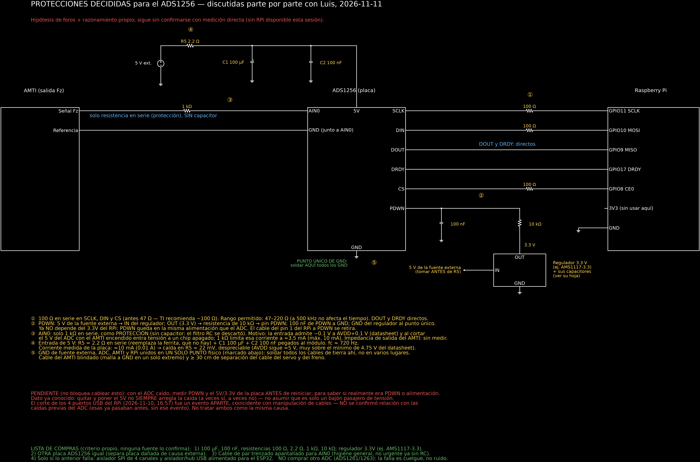

# 2026-11-11 — Protecciones decididas para el ADS1256 y selección de un ADC simultáneo

Sesión en la laptop, **sin Raspberry Pi ni simulador**: nada de esto está cableado ni probado.

## 1. Objetivo

1. Cerrar, parte por parte con Luis, qué protecciones se cablearán en el ADS1256 para reducir sus caídas.
2. Revisar si la comunicación o la velocidad de datos están fuera de los límites del datasheet.
3. Elegir un ADC que lea hasta 8 canales en el mismo instante para el producto final, con proveedor que la PUCP pueda usar.

## 2. Metodología

- Discusión bloque por bloque del esquema `esquemas/amti_ads1256_rpi/esquema_protecciones_ads1256.py` y regeneración del dibujo.
- Lectura del código `pruebas/leer_ads1256_fz.py` contra los límites del datasheet del ADS1256 (SBAS288).
- Lectura de `reportes/2026-11-10_restauracion_firmware_original.md` para el evento de USB del 2026-11-10.
- Búsquedas web (hojas de datos, foros TI E2E, distribuidores) y revisión directa de listados en amazon.com con envío a Lima.

## 3. Resultados

### 3.1 Datos nuevos dados por Luis

- El 5 V del ADC ya viene de una **fuente aparte** (10 A máx.), no del Raspberry Pi. Corriente que marca la fuente: ≈ 0.01 A.
- El ADC se cae **también sin mover nada**.
- Quitar y poner el 5 V **no siempre** lo recupera.
- Hoy PDWN solo está conectado al pin 1 (3.3 V) del Raspberry Pi; el segundo camino al pin 17 nunca se implementó.
- El corte de los 4 puertos USB del Raspberry Pi (2026-11-10, 16:57:00, ≈ 80 s) ocurrió **una sola vez**; las caídas del ADC ya pasaban antes. No se tratan como la misma causa.
- El producto final usará **8 canales o menos** a la vez.
- La PUCP no compra por AliExpress; sí por Amazon.

### 3.2 Protecciones decididas

| # | Bloque | Decisión | Motivo |
|---|---|---|---|
| ① | Líneas SPI (SCLK, DIN, CS) | 100 Ω en serie; rango permitido 47–220 Ω | TI recomienda ~100 Ω; a 500 kHz no afecta el tiempo. No ataca el cuelgue: es limpieza de señal |
| ② | PDWN | Regulador de 3.3 V propio, alimentado de la fuente externa de 5 V (tomado antes de R5) → 10 kΩ → PDWN; 100 nF de PDWN a GND. Se retira el cable al pin 1 del Raspberry Pi | PDWN deja de depender del Raspberry Pi |
| ③ | AIN0 | Solo 1 kΩ en serie, sin capacitor | Protección de corriente de la entrada (ver 3.3). El filtro RC se descartó: no ataca el cuelgue y la señal ya se lee bien |
| ④ | Entrada de 5 V | R5 = 2.2 Ω + 100 µF + 100 nF | Con 10 mA la caída es ≈ 22 mV, despreciable |
| ⑤ | Tierra | Un solo punto físico, marcado en el esquema | Evita diferencias de tensión entre tierras |

### 3.3 Código contra datasheet

- Velocidad de datos: 1000 muestras/s; el chip admite hasta 30 000. No hay saturación.
- Reloj SPI: 500 kHz, por debajo del máximo de 1.92 MHz (límite tomado del reporte del 2026-11-10, no releído del datasheet).
- La comunicación no explica el cuelgue: el 2026-11-10 se midió que RESET, WAKEUP y SDATAC no lo reviven.
- **Hallazgo abierto:** con el buffer apagado, la entrada admite de AGND − 0.1 V a AVDD + 0.1 V (máximo absoluto − 0.3 V, 10 mA continuos). La salida del AMTI es bipolar y ya se midió − 55 mV en reposo. Además, al cortar el 5 V del ADC con el AMTI encendido, AIN0 recibe tensión con el chip sin alimentar.
- Hipótesis (inferencia propia, **no verificada**, ningún foro la confirma): la tensión negativa o la entrada con el chip apagado podría dejar al ADS1256 trabado. Lo que no encaja: también se cae en reposo.

### 3.4 ADC simultáneo para el producto final

El ADS1256 lee sus 8 canales de uno en uno. Eso no causa las caídas, pero no cumple el requisito de lectura simultánea.

Elegido: **AD7606** (8 canales simultáneos, 16 bits, 200 000 muestras/s, entrada ±5 V o ±10 V con protección, 1 MΩ, alimentación 5 V, SPI o paralelo).

Alternativas vistas y por qué no:

| Opción | Motivo |
|---|---|
| AD7606B / AD7606C-16 | Mejores (entrada de 5 MΩ, reset que recupera la interfaz, detección de entrada abierta), pero no hay módulos en Amazon |
| ADS8588S, LTC2358-16 | Equivalentes o superiores, sin módulo disponible en Amazon |
| MCC 128 | Placa para Raspberry Pi con librería oficial, pero no es simultánea y no apareció en Amazon |
| ADS131M08 | 3.3 V; rango de entrada sin verificar |

Listados verificados en amazon.com el 2026-11-11, con envío a Lima:

| Vendedor | ASIN | Precio | Estado | Reseñas |
|---|---|---|---|---|
| Teyleten Robot | `B0FMFT1M9X` | US$17.99 | Disponible, enviado por Amazon | 2 (una buena; otra: unidad que no funcionó, mala documentación) |
| Reland | `B0CLJGDZ4Y` | US$32.00 | Quedan 2, enviado por Amazon | 2 (una: chip parece original, rinde según la hoja; reset activo en alto) |
| DIY-Module | `B0DP6ZWXKD` | US$17.99 | Enviado por Amazon | No leídas |

Las fotos del Teyleten y del Reland muestran **la misma placa** (PCB negro "AD7606 ADC with 16Bit", bornera verde de 8, tira doble de pines). La diferencia de precio es del vendedor.

**Compra propuesta, aún no hecha (decisión de Luis: no pedir todavía):** 3 × Teyleten = US$53.97. Envío gratis a Perú desde US$49; por debajo, ≈ US$16.30. Devolución hasta 2027-01-31 según el listado.

## 4. Limitaciones

- Ninguna protección está cableada ni probada. No se sabe si reducen las caídas.
- Sigue sin hacerse la medición clave: PDWN, 5 V y 3.3 V de la placa **con el ADC caído, antes de reiniciar**.
- Valores de los capacitores del regulador de 3.3 V: no verificados (dependen del modelo).
- Impedancia de salida del AMTI: sin medir. El 1 kΩ en AIN0 podría atenuar la señal; comparar con una pesa conocida antes y después.
- Rango real de salida del AMTI (cuánto baja en negativo): sin medir.
- AD7606: no se verificó que el chip de los módulos sea original; cada listado tiene solo 2 reseñas. No se verificó qué comprobante emite el vendedor ni si la PUCP lo acepta.
- Tiempo real con el AD7606: no medido. No hay librería madura para Raspberry Pi; el lector hay que escribirlo. Tiempo de conversión y configuración por pines: de memoria, no releídos del datasheet.
- Precios sin envío ni impuestos confirmados; el umbral de US$200 de importación debe verificarse en SUNAT.

## 5. Pendientes

1. Medir PDWN / 5 V / 3.3 V con el ADC caído.
2. Revisar si las caídas coinciden con Fz negativa.
3. Cablear las protecciones ①–⑤ y repetir la prueba de caídas.
4. **Análisis posterior: esquema de conexiones del AD7606 al Raspberry Pi** (pines SPI, CONVST, BUSY, RESET, selección de rango, nivel lógico de 3.3 V, protecciones y tierra). Sí hará falta cablearlo; no se ha diseñado.
5. Escribir y medir el lector del AD7606, y prueba de aceptación de varias horas con el servo en marcha.
6. Confirmar con compras de la PUCP el comprobante de Amazon.

## 6. Fuentes

- Datasheet ADS1256 (TI SBAS288): https://www.ti.com/lit/SBAS288
- TI E2E, voltajes negativos en ADC: https://e2e.ti.com/support/data-converters-group/data-converters/f/data-converters-forum/1048636/faq-can-my-adc-measure-negative-voltages
- TI E2E, data rate y cambio de canal del ADS1256: https://e2e.ti.com/support/data-converters-group/data-converters/f/data-converters-forum/660460/ads1256-how-to-understand-data-rate-and-channel-cycling-throughput
- AD7606 (Analog Devices): https://www.analog.com/en/products/ad7606.html
- AN-1559, migrar del AD7606 al AD7606B: https://www.analog.com/en/resources/app-notes/an-1559.html
- AD7606C-16: https://www.analog.com/en/products/ad7606c-16.html
- ADS8588S (TI): https://www.ti.com/product/ADS8588S
- LTC2358-16: https://www.analog.com/en/products/ltc2358-16.html
- MCC 128: https://www.measurementsystems.co.uk/measurement-computing/daq-for-raspberry-pi/mcc-128-voltage-measurement-16-bit-daq-hat-for-raspberry-pi
- Amazon, Teyleten: https://www.amazon.com/dp/B0FMFT1M9X
- Amazon, Reland: https://www.amazon.com/dp/B0CLJGDZ4Y
- Amazon, DIY-Module: https://www.amazon.com/dp/B0DP6ZWXKD
- Reporte interno del evento USB: `reportes/2026-11-10_restauracion_firmware_original.md`
