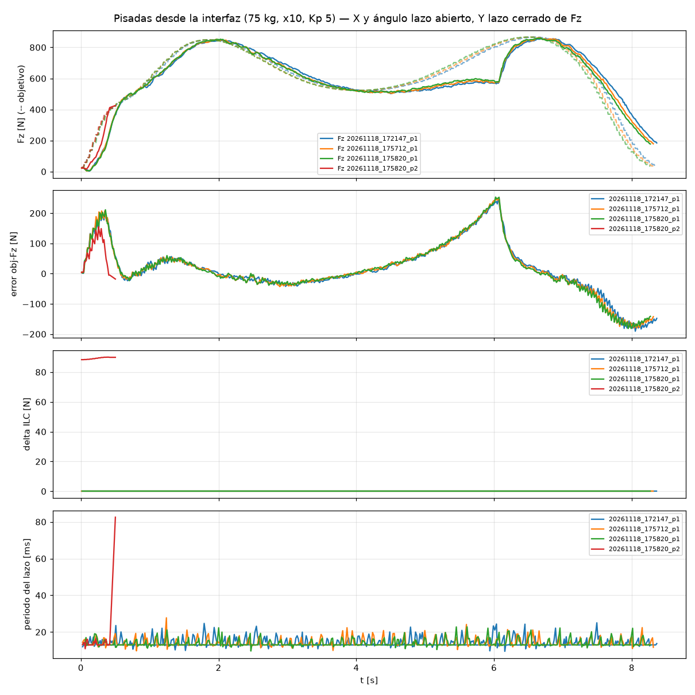

# Cable USB nuevo, HOME desde la interfaz vigente y orden de los repos — 2026-11-18 (noche, RPi)

## Objetivo
Retomar tras el reinicio de la RPi y el cambio de cable USB RPi↔ESP32 de motores (Luis), dejar el simulador calibrado (HOME sin prótesis) en la interfaz VIGENTE y continuar la prueba de 3 ejes (X y ángulo en lazo abierto, Y en lazo cerrado de Fz) donde quedó a las 17:21. Dejar documentado qué repo/interfaz se usa, para evitar confusiones en sesiones futuras (pedido de Luis).

## Metodología
1. Sin mover nada: `dmesg`, `vcgencmd get_throttled`, flujo UART del ADC (`/dev/ttyAMA0`, 2 s), 200 PING/PONG (`pruebas/medir_latencia_ping_pong.py`).
2. **Error mío (17:41):** abrí la copia OBSOLETA `~/Projects/gaitsim-control-fz` (siguiendo `INICIO_SESION_SIGUIENTE.md`, escrito de mañana) y pulsé HOME por software. Luis la mandó cerrar (cerrada por PID) y reinició el ESP32 → ese HOME quedó cortado.
3. Se identificó la interfaz vigente por evidencia: commits de la tarde en `~/Projects/gaitsim-control` (`main`, 15:56–17:35) y la transcripción de la sesión de la tarde (corrió desde ese directorio, `~/.claude/projects/-home-simgaitlibra-Projects-gaitsim-control/`). Su lanzador con canal de control se había perdido de `/tmp` con el reinicio: se reconstruyó desde la transcripción y se guardó en el repo: `herramientas/lanzar_interfaz_control.py` (puerto por id del CP2102; comandos en `logs/interfaz_cmd.txt`).
4. 17:49:56: interfaz vigente abierta con el lanzador; conectó (PING OK) y pulsó HOME (sin prótesis, OK de Luis).

## Resultado (medido)
- Cable nuevo: PING/PONG 200/200, RTT 5.992 ms (σ 0.108, máx 7.40) = igual que antes. `throttled=0x0`. ADC por UART ≈1000 paquetes/s. CSV: `pruebas/resultados/ping_pong_20261118_cable_nuevo.csv`.
- `cp210x ttyUSB0: failed set request 0x12 status: -110` aparece al abrir el puerto; ya salía 207 veces el 11-05 (no es del cable nuevo; no corta).
- **HOME OK 17:49:56 → 17:51:38:** `READY:24557:42397:-5000:5545`, posición tras HOME `16557:26397:545`. Log: `logs/interfaz_20261118_174943.log`.
- **Durante el HOME hubo un corte por EMI, pero en el bus del TECLADO** (`usb usb1-port2: disabled by hub (EMI?)`, bus 1 = HID); **el ESP32 (bus 3, cp210x) no se cortó.**

## Prueba de 3 ejes desde la interfaz (17:55–17:59) — X y ángulo en lazo abierto, Y en lazo cerrado de Fz
**Figura:** 
`figuras/2026-11-18_noche_pisadas_3ejes.png`: Fz y objetivo, error, delta ILC y periodo del lazo. Datos y su índice en `datos/2026-11-18_pisadas_3ejes_interfaz/` (LEEME.md). Generada con `herramientas/graficar_pisadas_interfaz.py`.

**Metodología:** prótesis montada por Luis tras el HOME; `preparar Control_apoyo_talla170_montaje37` (1.er intento con `talla170_montaje37` falló: **el id es el nombre COMPLETO del CSV sin .csv**; error mío); luego `fz … 75 10 1` y `fz … 75 10 5` (75 kg, x10, Kp 5 sugerido, v_max 9000).

**Resultado (medido):**
- Preparación: tara Y 10.54 cm (tarde 10.53), contacto a 28 N tras bajar 225 mm, partida 10 mm arriba y 1 cm atrás, X 19 cm, ángulo 11.1°.
- 3 primeras pisadas (17:21, 17:57, 17:58) **casi idénticas**: RMS 222 / 219.3 / 219.9 N (≈25 % del pico). Muy repetible, pero el error es grande y sistemático (es la 1.ª pisada de cada corrida: el ILC aún no actuó, delta = 0).
- Forma del error (igual en las 3): (a) carga inicial tardía, +200 N a ≈0.3 s; (b) **de 4.5 a 6.0 s Fz se queda en ≈580 N mientras el objetivo sube a 850 y Y baja a −3000 pasos/s (37 mm/s)**, luego salta de 580 a 800 N en ≈0.1 s; (c) descarga final tardía (−170 N). Hipótesis NO verificada para (b): en esa fase el pie rueda hacia la punta (ángulo → −37°) donde el Ensayo A midió k = 2.4 N/mm (11× más blando que talón/plana) → la misma bajada da mucha menos fuerza; el salto podría ser un cambio de contacto/holgura.
- Con la corrida de 1 pisada **sí llegó `FINISHED`** al terminar la trayectoria; el arreglo de TRAJ_STATUS (commit `f7345ae`) no se necesitó esta vez (no queda probado en hardware el caso sin FINISHED).
- **¿Por qué se paró la pisada 2 de 5?** Aborto por seguridad del detector de saltos: `Lectura anómala de Fz (522.2 N, previa 425.252)` a t = 0.50 s. En el CSV hay un **hueco de 82 ms entre dos ciclos del lazo** (lo normal es 13 ms, máx. 25 ms en las pisadas buenas); en ese tiempo Fz siguió subiendo y el salto entre muestras (97 N) superó el umbral (max(30, 8 % del pico) = 69 N). **No fue el cable ni el ADC.** Causa del hueco: no determinada (en la tarde ya se vio que el redibujado en vivo retrasa el hilo del lazo). El ILC de la pisada 2 empezó con delta ≈ 89 N casi constante (raro para un filtro de ≈1 Hz: revisar).
- **USB:** ningún corte del ESP32 de motores con el cable nuevo durante HOME + preparación + 2 corridas con carga hasta 850 N. La desconexión de 18:00:48 fue Luis desenchufando a propósito (sin `EMI`). El hub sí cortó el puerto del TECLADO por EMI durante el HOME → el ruido sigue; si el ESP32 vuelve a cortarse con este cable, la causa es el ruido/masa y no el cable.
- Periodo del lazo en la interfaz ≈ 13 ms (el script del proyecto: 10 ms).

## Cambios hechos al cierre (sin mover nada)
- Interfaz (`~/Projects/gaitsim-control`, `src/ui/screens/trajectory_screen.py`): el diálogo «Guardar Posición Inicial» ya no aparece cuando la corrida no la inició la pantalla de trayectorias (la preparación post-HOME y las pisadas de Fz usan la tara automática; pedido de Luis). Pruebas offscreen: post_home_flow, b6_fz_screen, ui_improvements, b5_run_with_fz_loop → TODO OK; `manual_test_trajectory_plot_isolation` se cuelga **también sin el cambio** (probado en un worktree con el código anterior): problema previo, no causado por esto. NO probado en hardware.
- Lanzador `herramientas/lanzar_interfaz_control.py`: por defecto muestra el flujo REAL tras el HOME (botón «Prótesis montada» → LISTA de trayectorias → confirmación → tara), que Luis opera en la pantalla; `--sin-dialogos` solo si Luis lo pide.
- Orden: `~/simulador-marcha-control/interfaz` → enlace a la interfaz vigente (para no salir de la carpeta principal); copia obsoleta renombrada a `~/Projects/gaitsim-control-fz_OBSOLETA_NO_USAR`.

## Pendientes que salen de esta prueba
1. Eliminar el hueco de 82 ms del lazo (hilo del lazo vs redibujado) o hacer el detector de saltos dependiente del tiempo transcurrido entre muestras (|ΔF|/Δt), sin subir el umbral a ciegas.
2. Correr ≥5 pisadas seguidas para ver si el ILC reduce el error de 25 % (nunca pasó de la pisada 2 en 3 ejes).
3. Investigar la meseta de 4.5–6 s (rigidez en punta, k variable por ángulo = Etapa 2 con CoP) y revisar el delta ILC ≈ 89 N constante.
4. Guardar automáticamente la imagen de las gráficas en vivo de la interfaz por pisada (hoy solo se guardan los CSV; la figura se rehace con el script).

## Limitaciones
- Un solo HOME con el cable nuevo; que el cable evite los cortes con el servo Y cargado aún no está probado (los cortes de la tarde ocurrieron también sin carga).
- El EMI sigue presente (afectó al teclado): el cable nuevo no elimina la causa, como mucho la tolera.
- El arreglo `TRAJ_STATUS` tras la pisada (commit `f7345ae` de la interfaz) sigue sin probarse en hardware.

## Orden de los repos (para no confundirse)
- `~/simulador-marcha-control` (este repo): scripts de control, pruebas, firmware, reportes, `CLAUDE.md` de la tesis.
- `~/Projects/gaitsim-control` (`main`): **interfaz vigente**, con el lazo de Fz integrado; su estado detallado en su `CLAUDE.md`.
- `~/Projects/gaitsim-control-fz` (`integracion-fz`): **OBSOLETA**, no abrir.
- Instrucciones de uso: `INICIO_SESION_SIGUIENTE.md` (aviso al inicio y § 6).

## Fuentes
`logs/interfaz_20261118_174943.log`, `dmesg` (RPi, arranque 17:36), `git log` de ambos repos, `~/Projects/gaitsim-control/CLAUDE.md` (bloque «Primera pisada con los 3 ejes»).
